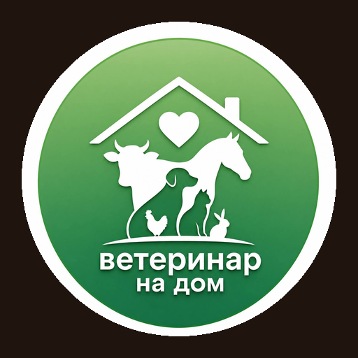

<p align="center">
  
</p>

<h1 align="center">📊 ВетДом · Руководитель · CRM — веб-версия для компьютера</h1>

**CRM компании «ВетДом» (ветеринар на дом)** — всё о бизнесе в одном месте для владельца и инвесторов: выручка и прибыль, финансы и счета, юнит-экономика, маркетинг, заказы, клиенты и их питомцы, ветеринары, услуги и магазин. Данные обновляются в реальном времени.

На компьютере — боковое меню и большие графики. На телефоне тот же код открывается как приложение: 3D-плитки разделов, вкладки внизу, кнопка «₽» по центру. Мобильная сборка для App Store и Google Play — в репозитории [VetWebCRM-mobile](https://github.com/arondrotsild-lab/VetWebCRM-mobile).

## Экосистема ВетДом — 6 приложений

| № | Приложение | Для кого | Репозиторий | Что внутри |
|---|---|---|---|---|
| 1 | 🌐 **Клиенты · Веб-версия для компьютера** | владельцы питомцев | [VETWEB](https://github.com/arondrotsild-lab/VETWEB) | вызов врача, карта, ветпаспорт, магазин + **общий сервер и база данных** |
| 2 | 📱 **Клиенты · Мобильное приложение** | владельцы питомцев | [VETWEB-mobile](https://github.com/arondrotsild-lab/VETWEB-mobile) | iPhone / Android / RuStore, собирается из кода №1 |
| 3 | 🩺 **Ветеринары · Веб-кабинет для компьютера** | врачи | [VetWeb-Veterinar](https://github.com/arondrotsild-lab/VetWeb-Veterinar) | заказы, доход, KPI-уровни, лига, профиль |
| 4 | 📲 **Ветеринары · Мобильное приложение** | врачи | [VetWeb-Veterinar-mobile](https://github.com/arondrotsild-lab/VetWeb-Veterinar-mobile) | iPhone / Android / RuStore, собирается из кода №3 |
| 5 | 📊 **Руководитель · CRM — веб-версия для компьютера** | владелец и инвесторы | **VetWebCRM** ← вы здесь | выручка и прибыль, финансы и счета, юнит-экономика, маркетинг, заказы, клиенты и питомцы, врачи, магазин |
| 6 | 💼 **Руководитель · CRM — мобильное приложение** | владелец и инвесторы | [VetWebCRM-mobile](https://github.com/arondrotsild-lab/VetWebCRM-mobile) | iPhone / Android, собирается из кода №5 |

Все приложения работают с **одним сервером и одной базой данных** (репозиторий VETWEB): заказ клиента сразу виден врачу и в CRM. Языки: русский, English, Türkçe, العربية (в CRM переключатель языка уже есть, перевод текстов CRM — в работе).

## Разделы CRM

| Раздел | Что внутри |
|---|---|
| 📊 **Сводка** | Выручка за месяц и прогноз, прибыль, визиты, средний чек, клиенты, питомцы, врачи, деньги на счетах; графики по месяцам и дням, план месяца, лучшие врачи, визиты «прямо сейчас», карта загрузки по часам |
| 💰 **Финансы и счета** | Отчёт о прибылях и убытках по месяцам, структура расходов по статьям (врачи, реклама, зарплаты, налоги, аренда…), 5 банковских счетов, движение денег, все операции |
| 📈 **Юнит-экономика** | Маржа с визита, стоимость клиента (CAC), ценность клиента (LTV), LTV/CAC, окупаемость, когорты возврата, годовая выручка (run-rate) |
| 📣 **Маркетинг** | 9 рекламных каналов: бюджет, показы, переходы, заявки, клиенты, цена клиента, окупаемость; воронка |
| 🧾 **Заказы** | Все визиты с поиском и фильтрами по статусу, периоду, услуге и врачу; карточка заказа с деньгами врача и компании |
| 👥 **Клиенты** | База с сегментами (новые, постоянные, VIP, спящие), выручка с клиента; карточка: питомцы, визиты, покупки, бонусы, пожертвования, приглашённые друзья |
| 🐾 **Питомцы** | Все животные, виды и породы, с чем обращаются |
| 🩺 **Ветеринары** | Загрузка, выручка, выплаты, рейтинг, уровни (Бронза 55% → Платина 70%), рост команды; карточка врача |
| 💉 **Услуги** | 13 направлений: визиты, выручка, средний чек, доля |
| 🛍️ **Магазин** | Продажи по месяцам и категориям, хиты, покупки бонусами |

## Цифры компании (демо-данные)

Компания за год выросла с ~1,3 до **~11,4 млн ₽ выручки в месяц** (октябрь 2026), вышла в плюс в мае, прибыль в октябре — **~1,08 млн ₽ (9%)**. 42 ветеринара, ~6 100 клиентов, ~7 600 питомцев.

## Запуск на Mac

```bash
npm install
npm run dev        # http://localhost:5175
```

CRM работает с общим сервером ВетДом из репозитория [VETWEB](https://github.com/arondrotsild-lab/VETWEB) (порт 3001, раздел API `/api/crm`, доступ только для роли «руководитель»). Вход — кнопка «Быстрый вход» (телефон `+79990000001`).

На телефоне: та же ссылка, или на компьютере в рамке телефона — `/phone.html`.

## Старая версия

Первая версия CRM (сделана в Replit), бизнес-план и презентация для инвесторов сохранены в папке [`old-replit-version/`](old-replit-version/).
